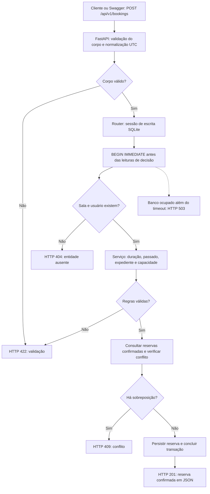

# SalaFácil - API de reserva de salas

Projeto do Bootcamp III, desenvolvido no fluxo SDD (Spec-Driven Development).
A Entrega 2 consolida a API, testes de borda, refinamentos e decisões técnicas.
A aplicação centraliza reservas de salas de reunião, evitando sobreposição de
horários, excesso de participantes e reservas fora do expediente.

## Equipe e repositório

| Integrante | RA |
|---|---|
| Gabriel Vieira Souza | 22552446 |
| Caio da Silva Diniz | 22552405 |

Repositório: [codewithcaio/Entrega-Inicial---bootcamp](https://github.com/codewithcaio/Entrega-Inicial---bootcamp).

## Funcionalidades e limites

- Cadastrar e consultar salas e usuários.
- Criar reservas com validação de duração, capacidade e expediente.
- Impedir conflitos entre reservas confirmadas da mesma sala, inclusive em escrita concorrente.
- Cancelar reservas de forma idempotente, mantendo o histórico e liberando o horário.
- Consultar reservas por sala, dia ou intervalo inclusivo de datas e por usuário.
- Consultar intervalos disponíveis de uma sala.

A interface para experimentar a API é o Swagger em `/docs`. Os contratos estão
na [SPEC v1.2](docs/SPEC.md). Autenticação/autorização real, notificações, recorrência
e múltiplos escritórios permanecem fora do escopo. Informar um ID de usuário não
comprova sua identidade nem implementa controle de acesso.

## Execução com Docker

Pré-requisitos: Git para clonar (ou baixar e extrair o ZIP), Docker em execução e
Docker Compose v2 com suporte a `--wait`. No Windows, usar Docker Desktop com
virtualização e backend WSL2 habilitados. A porta 8000 precisa estar disponível.

```bash
git clone https://github.com/codewithcaio/Entrega-Inicial---bootcamp.git
cd Entrega-Inicial---bootcamp
```

Para acompanhar as mudanças da Entrega 2 antes da integração final, selecionar
`develop`. Conferir a branch e o commit ao comparar código e evidências.
Opcionalmente, copiar `.env.example` para `.env` para personalizar o expediente.
Com os valores padrão, na raiz do projeto:

```bash
docker compose up --build --wait
docker compose run --rm api python scripts/run_tests.py
```

- [Swagger](http://localhost:8000/docs): executar as operações e conferir os schemas.
- [Saúde](http://localhost:8000/health): resposta `{"status":"ok"}`.
- [OpenAPI](http://localhost:8000/openapi.json): contrato legível por ferramentas.

O wrapper `docker compose run --rm api bash scripts/run_tests.sh` chama o mesmo
harness. O Compose monta `./evidence` no container, preservando no computador logs,
metadados, JUnit e cobertura em `evidence/tests/<data-hora-UTC>/`.

Para guardar os logs da API, o status e encerrar, em PowerShell:

```powershell
New-Item -ItemType Directory -Force evidence/docker | Out-Null
docker compose logs --no-color > evidence/docker/compose.log
docker compose ps -a > evidence/docker/status.txt
docker compose down
```

Em Linux/macOS, criar a pasta com `mkdir -p evidence/docker` antes dos mesmos
comandos de logs e encerramento. O volume `booking-data` preserva o banco quando
o ambiente é encerrado com `docker compose down`.

## Execução local alternativa

Usar Python 3.12 e as dependências de `requirements.txt`.

Windows / PowerShell:

```powershell
python -m venv .venv
.\.venv\Scripts\python.exe -m pip install -r requirements.txt
Copy-Item .env.example .env
.\.venv\Scripts\python.exe -m uvicorn app.main:app --app-dir src --reload
# Em outro terminal, na mesma pasta:
.\.venv\Scripts\python.exe scripts/run_tests.py
```

Linux / macOS:

```bash
python3 -m venv .venv
.venv/bin/python -m pip install -r requirements.txt
cp .env.example .env
.venv/bin/python -m uvicorn app.main:app --app-dir src --reload
# Em outro terminal, na mesma pasta:
.venv/bin/python scripts/run_tests.py
```

## Configuração, datas e persistência

| Configuração | Padrão e comportamento |
|---|---|
| `DATABASE_URL` | Local: `sqlite:///./data/booking.db`; no Compose: `sqlite:////app/data/booking.db`, no volume persistente |
| `BUSINESS_HOURS_START` | `08:00`, em UTC |
| `BUSINESS_HOURS_END` | `20:00`, em UTC; deve ser posterior ao início |

Localmente, variáveis explícitas do terminal prevalecem sobre o `.env`. No Compose,
o expediente é interpolado do ambiente/`.env`, enquanto a URL do banco é fixada
para o volume. Os testes usam bancos isolados e expediente fixo de 08:00 a 20:00 UTC.

Datas sem offset representam UTC. Datas com `Z` ou outro offset são convertidas
para UTC antes das regras e persistidas/retornadas sem sufixo. Por exemplo, 07:00
com offset -03:00 corresponde a 10:00 UTC. Ao criar uma reserva no Swagger,
escolher um instante futuro e dentro do expediente UTC.

O cancelamento lógico mantém a reserva como `CANCELLED`. Os intervalos são
semiabertos: uma reserva pode começar no instante em que outra termina.

## Arquitetura e fluxo da aplicação

| Componente | Responsabilidade |
|---|---|
| `src/app/main.py` | Inicialização, criação de tabelas no lifespan e registro dos routers |
| `src/app/schemas.py` | Contratos Pydantic e normalização UTC |
| `src/app/routers/` | Orquestração HTTP, consultas, persistência e respostas |
| `src/app/services/booking_service.py` | Regras puras: duração, passado, expediente, capacidade, conflito e disponibilidade |
| `src/app/database.py` e `models.py` | Sessões, transações e modelos SQLAlchemy/SQLite |
| `scripts/run_tests.py` | Harness com logs, JUnit, cobertura e verificação da meta de serviços |

Fluxo resumido de criação de reserva:



O diagrama representa as decisões de domínio, não a ordem de todos os callbacks
internos do FastAPI. A transação de escrita permanece ativa entre a leitura dos
dados de decisão e o commit/rollback. A espera pelo banco é limitada a 30 s;
quando excedida, a API responde 503 com `Retry-After: 1`. A disponibilidade usa
apenas reservas confirmadas daquela sala e dia.

### Decisões e trade-offs

- Python/FastAPI/Pydantic: contratos, validação e OpenAPI, com testes via TestClient.
- SQLite: simplicidade e persistência local; há apenas um escritor por vez.
- Serviços puros: testes isolados, complementados por testes HTTP e de concorrência.
- UTC sem offset na persistência: contrato uniforme; a apresentação em horário
  local deve converter os valores explicitamente.
- `BEGIN IMMEDIATE`: protege a decisão de conflito no SQLite; migrar para outro
  banco exige rever a estratégia transacional e os testes.

O [índice dos cinco ADRs](docs/adr/README.md) detalha contexto, alternativas,
consequências e status. O teste concorrente não é um teste de carga.

## Testes automatizados e resultados comprovados

| Execução | Resultado | Cobertura de app | Serviços | Evidência |
|---|---|---|---|---|
| Docker por Gabriel, 12/09/2026 | 78/78 aprovados; 55 avisos; saída 0 | 93,60% | 100% | [Relatório Docker](docs/EXECUTION_REPORT.md) |
| Python local após Issue #32, 15/10/2026 | 78/78 aprovados; 1 aviso; saída 0 | 93,60% | 100% | [Comparativo](docs/AVISOS_DEPRECACAO.md) |
| Python local após Issue #28, 15/10/2026 | 95/95 aprovados; 1 aviso; saída 0 | 94,51% | 100% | [Testes de borda](docs/TESTES_BORDA_ENTREGA2.md) |

95/95 significa **100% de passagem**, não 100% de cobertura. O harness exige ao
menos 80% de cobertura em serviços (RNF04). Avisos e tempos pertencem às execuções
identificadas; dependências transitivas podem variar entre ambientes.

Há testes unitários, HTTP com SQLite em memória e concorrência com conexões
independentes ao mesmo arquivo SQLite. Os 17 casos novos verificam limites,
prioridade de validação, ausência de persistência em erro, cancelamento e isolamento.
O aviso externo de Starlette/AnyIO permanece nos logs.

A execução Docker final da Entrega 2 pertence à
[Issue #34](https://github.com/codewithcaio/Entrega-Inicial---bootcamp/issues/34).
Os resultados locais de 95 testes não devem ser atribuídos a uma execução Docker
que ainda não foi registrada.

O [GitHub Actions](https://github.com/codewithcaio/Entrega-Inicial---bootcamp/actions)
executa `test` e `docker-test` em pushes e PRs para `develop` e `main`, publicando
evidências como artefatos. Conferir o resultado de cada PR em Checks.

## Uso de IA e revisão humana

**Gabriel Vieira Souza utilizou o OpenAI Codex no aplicativo desktop** para
inspecionar/alterar arquivos, executar testes e preparar documentos. As capturas
do [README](evidence/ai/codex-readme.png) e do
[relatório](evidence/ai/codex-relatorio.png) documentam uma interação real.
O material original declara Claude Code; essa declaração é distinta das capturas
de Codex desktop e não comprova uso do executável Codex CLI.

O contexto dos assistentes inclui SPEC, refinamentos, ADRs e `AGENTS.md`. O fluxo
exige branches, PRs, validação automática e revisão do outro integrante antes do
merge, conforme [CONTRIBUTING.md](CONTRIBUTING.md). Os PRs iniciais #1-#7 não
tiveram aprovação formal prévia registrada; revisões posteriores não são retroativas.

A [análise comparativa e ético-técnica](docs/RELATORIO_ETICO_TECNICO.md) reúne
a comparação das ferramentas, os riscos, os controles e o relato de experiência
da Issue #31. O texto distingue uso comprovado de pesquisa documental.

## Mapa da documentação e submissão

- [SPEC](docs/SPEC.md): requisitos, contratos, limites e critérios da Entrega 2.
- [REFINEMENTS](docs/REFINEMENTS.md): problemas, decisões e loop de re-especificação.
- [ADRs](docs/adr/README.md): decisões de arquitetura e trade-offs.
- [Histórico das correções](docs/CHANGELOG_REVIEW.md).
- [Comparativo de depreciações](docs/AVISOS_DEPRECACAO.md).
- [Inspeção e testes de borda](docs/TESTES_BORDA_ENTREGA2.md).
- [Evidências](evidence/README.md): arquivos brutos e capturas por execução.

Consolidar o PDF da Entrega 2 com integrantes/RA, repositório, execução final,
análise de IA, experiência do grupo e PRs relevantes. Cada integrante deve enviar
o PDF conforme o enunciado da disciplina.
